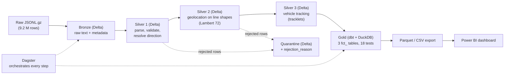

# stib-lakehouse-streaming


A batch medallion pipeline (Bronze / Silver / Gold) that turns one week of raw real-time vehicle positions from the Brussels public transport operator (STIB/MIVB) into three analytical tables: commercial speed, headway regularity and data-collection health. Bronze and Silver are stored as **Delta Lake** tables.

> **Honest scope note.** Despite the repository name, this is a **batch** project. There is no Kafka and no Structured Streaming. Delta Lake is used for its ACID overwrites and its transaction log; the pipeline does not use `MERGE` yet (see [Limits and next steps](#limits-and-next-steps)).

## Problem and data

The STIB open-data API returns, for each stop, the next vehicles expected. It was polled every 30 seconds from **4 to 10 May 2026**, which gives about **9.2 million raw rows** (`data/raw/*.jsonl.gz`, one file per day). Static reference data (stops, line stops, line terminus, line shapes) lives in `data/static/`.

The raw feed is not directly usable: some lines and stops are unknown, the direction of travel is missing for many rows, and a vehicle is never identified by a stable id. The pipeline has to clean it, locate each vehicle along its line, rebuild vehicle trajectories, and only then compute indicators.

`data/` is not versioned (data volume).

## Architecture



| Layer | Tool | What it does |
|---|---|---|
| Bronze | PySpark, Delta | Reads raw files as text, adds `source_file` and ingestion timestamps. Nothing is dropped. |
| Silver 1 | PySpark, Delta | Parses the JSON, checks lines and stops against the static data, resolves the direction, sends invalid rows to quarantine. |
| Silver 2 | PySpark + pandas UDF, Delta | Projects every position onto the line shape (Belgian Lambert 72, metres) to get a curvilinear position `s_m`. |
| Silver 3 | PySpark + pandas UDF, Delta | Rebuilds vehicle trajectories ("tracklets") with a greedy curvilinear matching, per line / direction / service day. |
| Gold | dbt Core + DuckDB | Reads Silver 3 with `delta_scan` (DuckDB `delta` extension). 6 models (1 staging view, 2 intermediate tables, 3 marts) and 18 tests. |
| Serving | DuckDB, Parquet, Power BI | `src/export_gold.py` exports the 3 marts for BI. |
| Orchestration | Dagster | One asset per Spark job, dbt models as assets, export as the last asset. |

## Key design choices

On the 9,213,400 input rows of Silver 1: 8,510,003 valid and 703,397 quarantined (`UNRESOLVED_DIRECTION` 491,970, `UNKNOWN_LINE` 118,328, `UNKNOWN_STOP` 90,260, `EXTREME_DISTANCE` 2,839). Silver 2 quarantines 34,930 more (`BEYOND_SEGMENT`). Row counts always add up, and a rule can be revised without re-reading the source. A full replay from the raw files reproduces the same row counts at every layer, first checked on 24 November 2026 on Parquet (about 5.5 minutes in Docker), then again on Delta on 25 November 2026 (about 7 minutes: Bronze and Silver 1 run locally, Silver 2 and 3 in Docker).

- **Delta Lake for Bronze and Silver.** Every job writes with `overwrite`; Delta makes that write atomic (a crashed job leaves the previous version readable, because files only count once they appear in `_delta_log`). The log also allows time travel and schema enforcement.
- **No content-based deduplication.** 3.35 % of rows look like duplicates, but 98 % of them are at distance 0 (several vehicles at the same stop), so they are kept. Details in [docs/findings.md](docs/findings.md).
- **Direction resolution cascade.** First by exact terminus match, then by "this stop belongs to only one direction". Each row records the method used (`direction_method`).
- **Lambert 72 (EPSG:31370).** Distances are computed in a metric projection, not on raw latitude / longitude. Each stop-to-stop segment gets its real length, which replaced a provisional 5,000 m threshold.
- **Tracking.** Vehicles have no id, so trajectories are rebuilt by matching consecutive observations on position along the line, with limits on speed and backward movement. The service day is shifted by 4 hours so trips are not cut at midnight.
- **Speed from travel times between stops.** The metro is only observed at stations, so speed between 30-second polls would be meaningless. The speed is computed from the time between consecutive stop arrivals.
- **dbt tests on grain and plausibility.** `unique` / `not_null` / `accepted_values` plus custom tests: grain of each table, plausible speeds bounded above and below, completeness not above 101 %, and Gold tables not empty.

## Results

Silver output: 8,475,073 located rows, 7,939,963 tracked observations, 126,304 tracklets (median duration 29.5 min).

Three Gold tables:

| Table | Content |
|---|---|
| `fct_line_speeds` | Commercial speed per line, direction and local hour. |
| `fct_headway_regularity` | Median headway, coefficient of variation, % of bunching and of gaps, per line, direction and hour. |
| `fct_collection_health` | Polls received per local hour against the 120 expected. |

What the data shows: the metro stays at 26 to 28 km/h at any hour, while surface lines slow down at rush hours. The 10 lines most affected by bunching are all bus or tram lines. A drop in collection on 6 May afternoon points to a collector outage.


The report file is [bi/stib_dashboard.pbix](bi/stib_dashboard.pbix). Analysis notes and data findings are in [docs/findings.md](docs/findings.md).

## How to run

Requirements: Python 3.11, Java 17+ (for Spark; Java 19 was used), and on Windows `winutils.exe` / `hadoop.dll` in `C:\hadoop` (or `HADOOP_HOME`). The raw and static data are not in the repository, so the Spark jobs need your own copy in `data/raw/` and `data/static/`. The first Spark run downloads the Delta jars from Maven, and the first dbt run downloads the DuckDB `delta` extension, so both need an internet connection once.

```powershell
python -m venv .venv
.\.venv\Scripts\Activate.ps1
pip install -r requirements.txt
```

**Tests** (from the repository root; the Spark tests take a few minutes):

```powershell
python -m pytest
```

**Spark jobs** (from the root; each job reads the previous layer, and the full run is long). Output goes to `data/delta/`:

```powershell
python -m src.spark_jobs.bronze_ingestion
python -m src.spark_jobs.silver_cleaning
python -m scripts.build_stop_offsets
python -m src.spark_jobs.silver_geolocation
python -m src.spark_jobs.silver_tracking
```

**Gold** (from `dbt_stib/`, once Silver exists):

```powershell
cd dbt_stib
dbt build --profiles-dir .
dbt docs generate --profiles-dir .
```

**Export for BI**, then **orchestration** (from the root):

```powershell
python -m src.export_gold
dagster dev -m orchestration.definitions
```

**With Docker.** The image contains Python, Java, Spark, the Delta jars, dbt and Dagster. It can run without network access once built.

```powershell
docker build -t stib-lakehouse .
docker run --rm stib-lakehouse python -m pytest
docker compose up dagster        # Dagster UI on http://localhost:3000
```

For the Spark jobs, mount the data folder and limit resources if your Docker VM is small:

```powershell
docker run --rm --cpus 2 -e SPARK_DRIVER_MEMORY=2g -e SPARK_SHUFFLE_PARTITIONS=4 -v "${PWD}/data:/app/data" stib-lakehouse python -m src.spark_jobs.silver_geolocation
```

## Continuous integration

GitHub Actions runs two jobs on every push and pull request: `tests` (pytest, Java 17, Python 3.11) and `dbt` (`dbt build` on a 2.9 MB Delta fixture made of two lines and two service days, rebuilt with `scripts/make_ci_fixture_delta.py`).

## Limits and next steps

Known limits:

- Batch only: one fixed week, no incremental processing, jobs overwrite their output. Because of that, each Delta table only has one version per run and time travel is not used by the pipeline.
- Tracking has no chain-merge step: 9.29 % of tracklets are short fragments, which can inflate the bunching indicator. The bunching average is not weighted by number of headways.
- Tracking is not strictly deterministic: on a replay, 2 observations out of 7.94 million were assigned to a different tracklet, because tie-breaking depends on row order. A sort by timestamp, position and observation key before matching would fix it.
- A poll with no vehicle is indistinguishable from a stopped collector, so "no service" and "outage" cannot be separated without a heartbeat log on the collection side.
- Line 4 has no shape in the static data (206,130 rows without position).
- Thresholds (for example the tracking limits) were tuned by hand on this week of data.
- No retries, checkpoints or schedule on the orchestration side.
- The raw collector is not part of this repository.

Next steps, in the order I plan to do them:

1. **Delta Lake features**: `MERGE`-based incremental reruns, `OPTIMIZE` / `VACUUM`, a schema-enforcement test.
2. **Kafka / Redpanda + Spark Structured Streaming** to replace the polling files, with deduplication on message identity.
3. **Superset** (or similar) as a BI layer that can run in a container, instead of a Power BI file.
4. Chain-merge of tracklets, deterministic tracking order, and a heartbeat log for the collector.

## License

See [LICENSE](LICENSE).